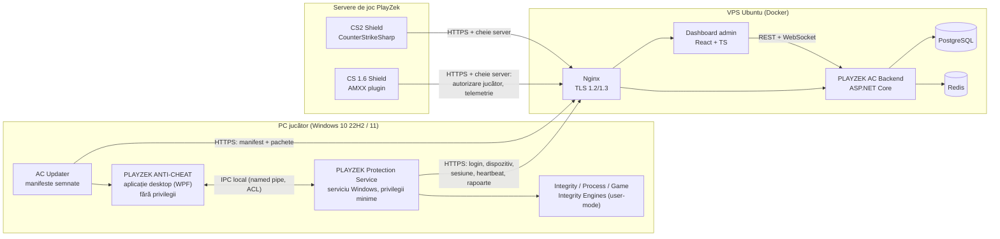
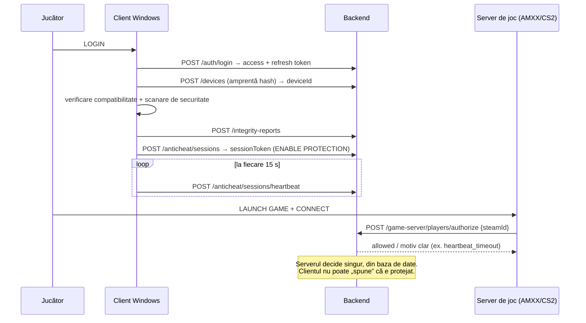

# PLAYZEK ANTI-CHEAT — Arhitectură tehnică

## 1. Inventarul mediului (inspectat la 23.11.2026)

| Element | Ce există |
|---|---|
| Repository GitHub | `bling1gaming-lgtm/playzek-anticheat` — doar `LICENSE` (Apache 2.0) |
| Cod existent | Client Electron + backend Node/Express/SQLite + plugin AMXX (mutate în `legacy/`, păstrate ca referință) |
| Unelte Windows | .NET SDK 10.0.404 și 8.0, Node 26, Git 2.56, winget |
| Lipsesc local | compilator C++ (MSVC/Windows SDK), Docker, PostgreSQL, Redis, WSL, Inno Setup/WiX, AMXX compiler |
| Ubuntu | VPS-ul jucătorului — nu e accesibil din această sesiune |
| Servere de joc | Nu există încă servere CS 1.6/CS2 conectate |
| Autentificare existentă | Doar cea din `legacy/node-backend` (bcrypt + JWT, SQLite) |

## 2. Alegerea tehnologiilor

| Componentă | Tehnologie | De ce |
|---|---|---|
| Backend | **ASP.NET Core (.NET 10)**, minimal APIs | Recomandat de spec; același limbaj ca clientul Windows; compilabil și testabil pe această mașină; rulează nativ pe Ubuntu și în Docker |
| Bază de date | **PostgreSQL 17** + EF Core 10 (Npgsql) | Cerut de spec; migrații versionate în repo; FK, indecși, constrângeri `CHECK` |
| Cache / rate limit / evenimente live | **Redis** (faza 5–7) | Cerut de spec. Până atunci: rate limiting în memoria procesului (o singură instanță) |
| Client Windows | **C# / .NET 10, WPF** (faza 2) | Aplicație desktop nativă, fără runtime web; acces la API-urile Windows documentate |
| Serviciu de protecție | **.NET Worker Service** ca serviciu Windows, cont cu privilegii minime (faza 2–3) | UI-ul și serviciul sunt componente separate, cum cere spec-ul |
| Componente native | **C++20** (faza 3, după instalarea MSVC) | Doar unde .NET nu ajunge (ex. verificări WinTrust/CI la nivel jos). Tot user-mode, fără driver de kernel |
| Dashboard | **React + TypeScript** (faza 5) | Cerut de spec |
| CS 1.6 | **AMX Mod X / Pawn**, compatibil ReHLDS/ReAPI (faza 4) | Cerut de spec |
| CS2 | **CounterStrikeSharp** (plugin .NET pe Metamod:Source) (faza 6) | Cel mai folosit mecanism de plugin server pentru CS2; tot .NET |
| Instalator | MSI (WiX) sau Inno Setup, semnat (faza 2) | Cerut de spec; code signing cere un certificat pe care trebuie să-l cumpere proprietarul |

## 3. Diagrama de componente

### Fluxul cerut de spec și cine îl validează

## 4. Granițele modulelor (backend)

| Proiect | Responsabilitate | Module din spec acoperite |
|---|---|---|
| `backend/data/Playzek.Data` | Entități, `PlayzekDbContext`, migrații PostgreSQL | schema bazei de date |
| `backend/authentication/Playzek.Authentication` | parole, JWT, refresh tokens, dispozitive, sesiuni anti-cheat, autorizare servere de joc, audit | Authentication, Player Management (parțial), Device Registration, Session Management, Game Server Registration, Server Authorization, Audit Logs |
| `backend/api/Playzek.Api` | host HTTP, endpoint-uri, rate limiting, health, rapoarte de integritate, comenzi CLI | Integrity Reports, Health Monitoring |
| (faza 5) `backend/detection`, `backend/behavioral-engine` | detecții, dovezi, analiză comportamentală | Process Detection, Behavioral Analysis, Evidence, Ban Management |
| (faza 7) `backend/update-service` | manifeste semnate, canale | Update Distribution |

## 5. Decizii de securitate

- **Parole**: PBKDF2-HMAC-SHA512, 100.000 iterații, sare per parolă (formatul ASP.NET Core Identity v3). Blocare cont după 5 încercări greșite, 15 minute.
- **Token de acces**: JWT HS256, 15 minute, cheie din variabilă de mediu (aplicația refuză să pornească cu o cheie sub 32 de octeți).
- **Refresh token**: opac, 256 biți, stocat doar ca SHA-256, rotit la fiecare folosire; reutilizarea unui token rotit revocă toate token-urile utilizatorului.
- **Sesiune anti-cheat**: token opac stocat ca hash; validă doar dacă: status activ, cont activ, dispozitiv activ, fără ban activ, sub durata maximă (6 h) și cu heartbeat în ultimele 45 s. O singură sesiune activă per jucător. Reînnoirea rotește token-ul.
- **Servere de joc**: cheie API per server (`pzs_<id>_<secret>`), stocată doar ca hash; serverul identifică jucătorul după SteamID, deci clientul nu poate falsifica autorizarea.
- **Date minime**: amprenta dispozitivului ajunge deja hash-uită de la client și e re-hash-uită pe server; rapoartele de integritate nu acceptă conținut de fișiere; clientul nu poate raporta „încălcare confirmată” (asta e doar decizie umană).
- **Fără endpoint-uri admin neautentificate**: până la dashboard (cu MFA), operațiile admin se fac din CLI pe VPS.
- **Fără driver de kernel** în versiunea inițială.

## 6. Limitări cunoscute (oneste)

- Nicio componentă anti-cheat client-side nu poate garanta detectarea tuturor cheat-urilor; protecția e stratificată (local + server + comportamental).
- Rate limiting-ul e per instanță până la integrarea Redis.
- JWT-ul de acces nu poate fi revocat înainte de cele 15 minute (doar refresh token-ul); compromisul e documentat și acceptat de durata scurtă.
- Code signing-ul pentru instalator și executabile necesită un certificat EV/OV cumpărat de proprietar.
